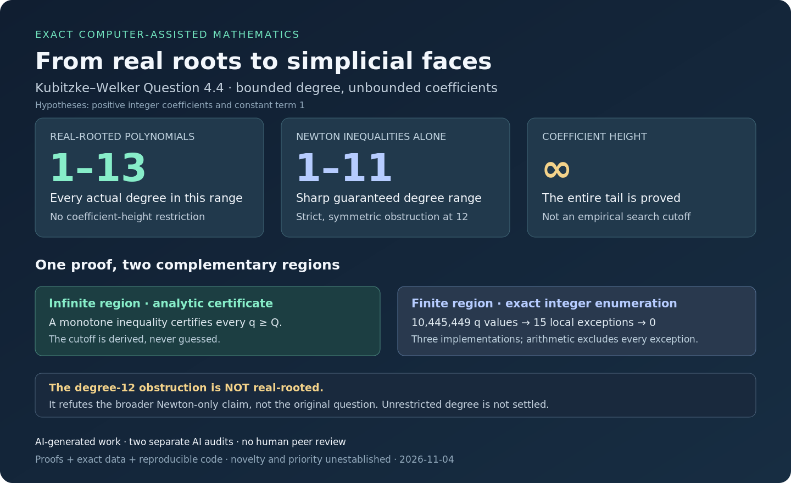

# Real-rooted polynomials, initial differences, and simplicial complexes

**An exact computer-assisted result for Kubitzke–Welker Question 4.4 in degrees at most 13.**



This repository contains a proof, exact certificates, and three implementations of the finite computation. The coefficient sizes are **unbounded**: an analytic argument covers the entire infinite tail. This is not just a search below a chosen height.

**Research status:** AI-generated mathematical work, separately checked by two AI review processes. **No human peer review, no proof-assistant formalization, and no established novelty or publication priority.** The unrestricted question remains unresolved here. See [claim boundaries and provenance](PROVENANCE.md).

## The result

Let

$$
h(t)=1+h_1t+\cdots+h_dt^d,\qquad h_i\in\mathbb Z_{>0},\qquad 1\le d\le13,
$$

have only real zeros. For every strictly increasing initial prefix
$1<h_1<\cdots<h_r$, the vector

$$
(1,h_1-1,h_2-h_1,\ldots,h_r-h_{r-1})
$$

is the **f-vector of a simplicial complex**. Here the first entry counts the empty face, and subsequent entries count vertices, edges, and higher-dimensional faces.

The target is [Kubitzke–Welker, Question 4.4, p. 17](https://www.mathematik.uni-marburg.de/~welker/preprints/Veronese.pdf), also [Brenti, Problem 2.10](https://arxiv.org/html/2410.09897v1). It is the initial-difference **Kruskal–Katona** assertion, not just Macaulay growth or the separate coefficient-vector conjecture.

| Hypotheses | Scope established here |
| --- | --- |
| Positive integer coefficients, constant term 1, real-rooted | Every actual degree 1–13; no coefficient-height bound |
| Positive integer coefficients, constant term 1, full degree-d Newton inequalities | Every actual degree 1–11 |
| Same Newton hypotheses, even with strict inequalities and symmetry | Fail in degree 12 |
| Real-rooted, with $h_1\le d+1$ | Every degree, by a classical small-trace classification and explicit realization |
| Arbitrary degree with no trace restriction | **Not settled** |

## Why a finite computation proves an unbounded statement

Put $g_i=h_i-h_{i-1}$. Kruskal–Katona asks for
$g_{k+1}\le K_k(g_k)$, where $K_k$ is the simplicial upper operator.

1. **Analytic bound.** Full degree-d Newton inequalities imply a strict, degree-sensitive power bound for consecutive positive differences.
2. **Infinite tail.** A monotonicity proof and one exact integer comparison certify every $g_k\ge Q_{d,k}$.
3. **Finite region.** Enumerate every $1\le g_k<Q_{d,k}$, retaining only necessary exact integer conditions. No floating-point root tests are used.
4. **Final exceptions.** Small-trace algebraic-integer classification and elementary Newton inequalities exclude all remaining tuples.

| Computation | Index cases | Finite q values | p pairs in the submitted scan | Local exceptions | Final survivors |
| --- | ---: | ---: | ---: | ---: | ---: |
| Degrees 3–12 | 55 | 2,639,778 | 14,139,264 | 7 | 0 |
| Degree 13 | 11 | 7,805,671 | 46,442,223 | 8 | 0 |
| Total | 66 | 10,445,449 | 60,581,487 | 15 | 0 |

Degrees 1–2 and the first Kruskal–Katona inequality are handled analytically. A local exception is a tuple surviving necessary filters, **not a counterexample polynomial**.

Read the [degree-12 proof](proofs/degree12_proof.md), then the [degree-13 extension](proofs/degree13_extension.md). The [general finite reduction and sharp continuous envelope](proofs/finite_reduction.md) and [small-trace classification and realization](proofs/small_trace_case.md) give the supporting arguments.

## Reproduce it

Requires **Python 3.8+**, with no third-party packages for the main proof certificates.

```sh
python tools/reproduce.py --quick
python tools/reproduce.py
```

The quick run checks the committed file hashes and unit tests. **It is not the full enumeration.** The full run additionally executes all six certificate scripts in a temporary directory, compares every generated JSON file with its committed counterpart, and cross-checks all 66 rows across the three implementations. It refuses optimized Python (`-O`) because the verifiers use assertions. Generated logs and a replay summary go to `build/`, never into the checked-in certificates. Allow several minutes for the full run; time depends on the machine.

The implementations are:

- **Submitted scan:** binary-search binomial expansions and explicit p scanning.
- **Independent AI audit A:** binomial-block Kruskal–Katona tables and a separate scan.
- **Independent AI audit B:** a separate combinadic calculation and exact quadratic-interval feasibility. It does **not** use the submitted power pruning or p-range scan.

The proof still requires mathematical review of the analytic reduction and the final classifications. Running code alone does not verify those arguments. [Reproducibility details](REPRODUCIBILITY.md) explain the trust boundary, commands, and certificate schema.

## The degree-12 obstruction is not a counterexample to the original question

The palindromic coefficient vector

```text
1, 13, 74, 255, 575, 921, 1075, 921, 575, 255, 74, 13, 1
```

satisfies every degree-12 Newton inequality strictly. Its differences have
$g_2=61$ and $g_3=181$, while $K_2(61)=180$. Thus the Newton-only degree range is sharp.

But this polynomial is **not real-rooted**. Its gamma-vector is
$(1,1,-2,6,-20,21,-3)$; the negative entries contradict the nonnegative gamma coefficients forced by positive palindromic real-rootedness. The original question's hypotheses fail. The exact vector, slacks, and gamma data are in [the quadratic-interval certificate](certificates/referee_degree12_alternative.json).

## Find your way around

- [`proofs/`](proofs/): complete arguments, scope, and related results.
- [`src/`](src/): six original certificate programs, preserved byte for byte.
- [`certificates/`](certificates/): all six exact outputs.
- [`audits/`](audits/): explicitly labeled AI-only mathematical and computational reviews.
- [`tests/`](tests/): small exact cross-checks, endpoint cases, and obstruction tests.
- [`extras/`](extras/): optional exploratory/structural checks, including exact SymPy Sturm checks. They are not required for the main result.
- [Primary sources and prior-art distinctions](SOURCES.md).
- [Provenance, limitations, and licensing status](PROVENANCE.md).

No license has been selected for this repository. External papers are linked, not redistributed. The classical ingredients and the original question belong to their cited authors; no novelty is claimed for them.
